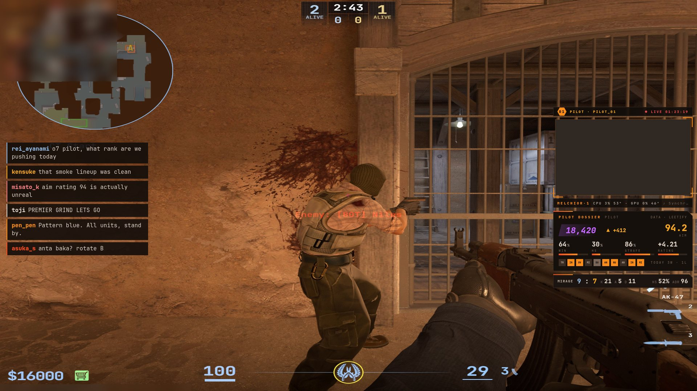
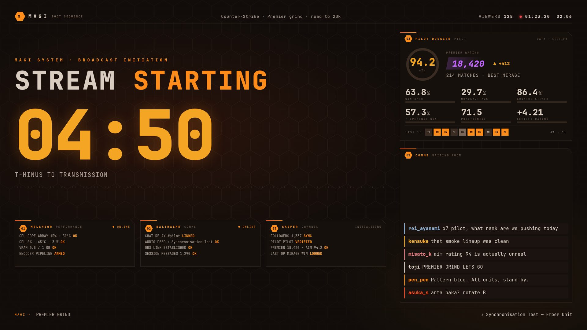
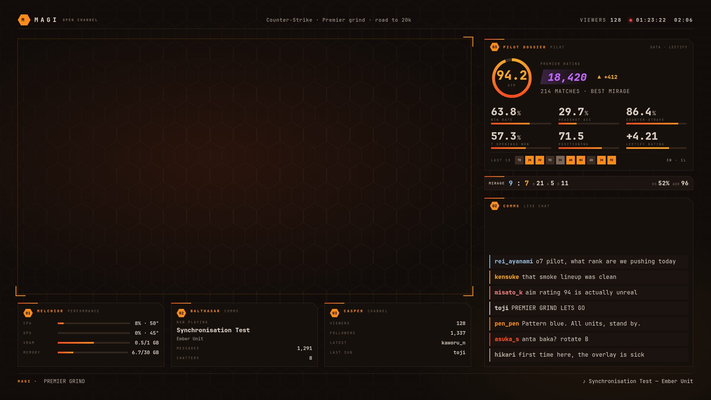
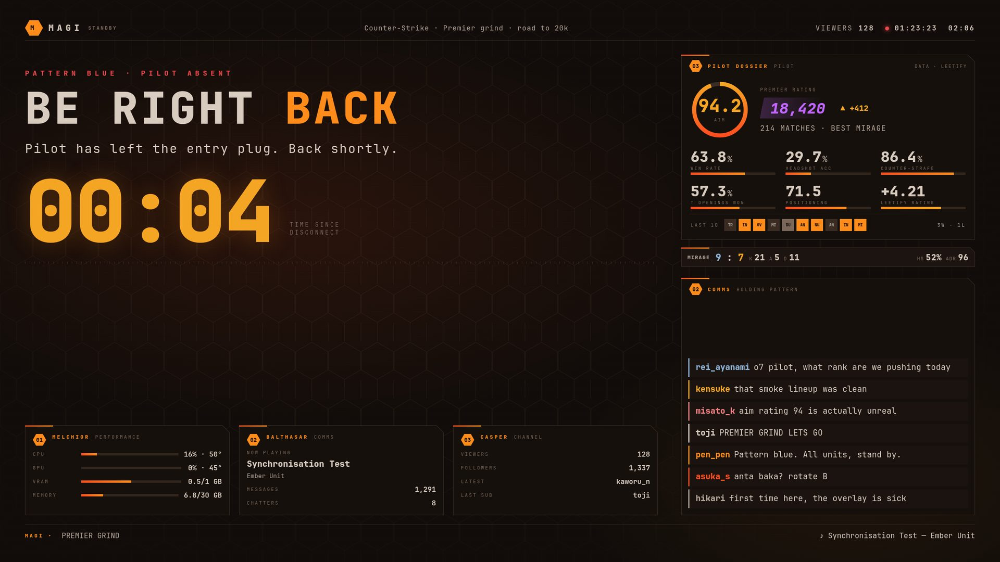
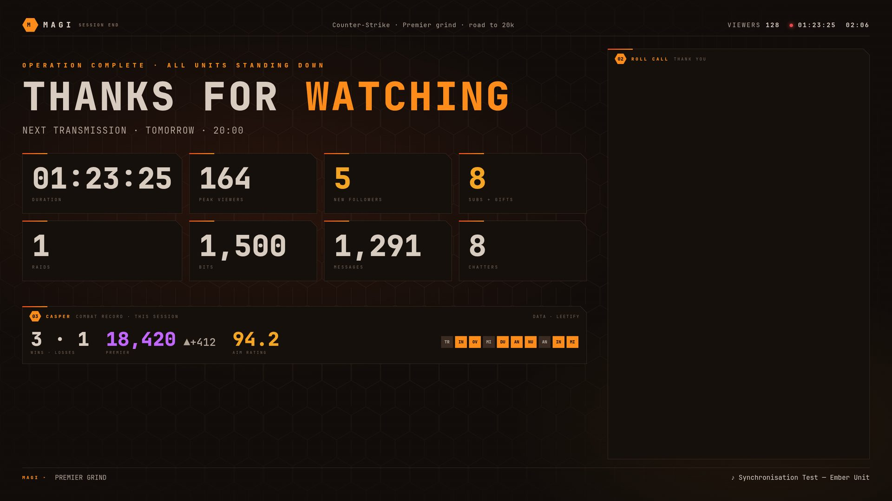
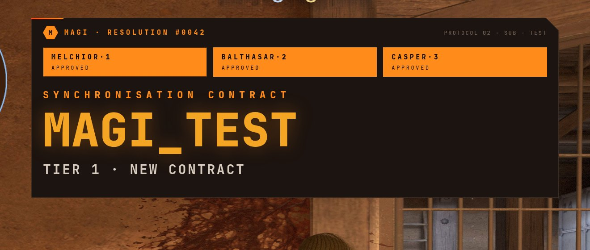

# magi-overlay

[](https://github.com/Tjabooo/magi-overlay/actions/workflows/ci.yml) [](https://github.com/Tjabooo/magi-overlay/releases) [](LICENSE)

A self-hosted, MAGI-themed stream overlay for OBS: Twitch chat and alerts, live CS2 match stats, Leetify
profile stats, system stats and now playing, served as browser sources from one small Rust binary.



| Starting soon | Chatting |
| --- | --- |
|  |  |
| **Be right back** | **Ending** |
|  |  |



## Features

- **Six scene pages**: starting soon (countdown + boot sequence), gameplay, just chatting, be right back
  (away timer), ending (session summary + roll call) and alerts.
- **One command builds the OBS scenes** through obs-websocket (`magi-overlay setup`, safe to re-run).
- **Twitch chat** with emotes and badges, deleted messages and bans removed live; works anonymously with just
  your channel name.
- **Alerts** as a three-unit "MAGI vote": follows, subs, resubs, gifts, gift bombs, raids, bits and channel-point
  redemptions, with synthesized sounds (no audio files) and a queue.
- **CS2 live match strip** from Game State Integration: score, K/A/D, headshot %, ADR, kill flashes. Only your
  own stats count; spectated teammates don't overwrite them.
- **Pilot dossier** from the public [Leetify](https://leetify.com) API: Premier rating (in its CS2 tier colour) with
  today's change, aim rating, win rate, headshot accuracy, counter-strafing, opening duels, last 10 matches.
- **System stats** (CPU, GPU, VRAM, RAM, temperatures) straight from sysfs, and **now playing** via MPRIS.
- **Control dock** for OBS: countdowns, BRB message, test alerts, chat test, session reset, live status.
- Cheap to run: hidden scenes unload, no endless animations, no subprocess polling.
- `serve --demo` fills everything with sample data for previews.

## Install

Linux, Rust 1.85+:

```sh
git clone https://github.com/Tjabooo/magi-overlay && cd magi-overlay
cargo build --release
install -Dm755 target/release/magi-overlay ~/.local/bin/magi-overlay
```

Optional: `playerctl` for now playing. The pages use the "JetBrainsMono Nerd Font" (falls back to
JetBrains Mono, then any monospace font).

## Usage

1. Copy `config.example.toml` to `~/.config/magi-overlay/config.toml` and set at least `[twitch] channel`
   and the names of your OBS camera and screen sources.
2. Enable obs-websocket in OBS (Tools → WebSocket Server Settings).
3. Start the server: `magi-overlay serve` (or install `contrib/magi-overlay.service` as a user unit).
4. Build the scenes: `magi-overlay setup`. You get `starting`, your gameplay scene, `chatting`, `brb` and
   `ending`, each with its page and the shared alerts source.
5. Optional extras:
   - **Twitch API** (follows, viewer count, badges, channel points): create an app at
     <https://dev.twitch.tv/console/apps> (Client Type **Public**, any HTTPS redirect URL, e.g.
     `https://localhost`), put its Client ID in `[twitch] client_id`, run `magi-overlay login` and approve.
   - **CS2 live stats**: `magi-overlay cs2-config`, copy the printed `gsi_token` into the config, restart the
     server and CS2.
   - **Leetify dossier**: set `[cs2] steam_id` (your SteamID64; your Leetify profile must be public).
   - **Control dock**: OBS → Docks → Custom Browser Docks → `http://127.0.0.1:7788/overlay/control`.

From a terminal or a hotkey:

```sh
magi-overlay countdown 5m            # starting scene countdown (also 90s, 4:30, off)
magi-overlay message "Back in 5"     # BRB message
magi-overlay test raid               # follow, sub, resub, gift, giftbomb, raid, bits, redeem
magi-overlay session-reset           # start counting a new session now
magi-overlay status                  # what the overlay currently knows
```

### Going live

`POST /api/golive` (with an `X-Magi: 1` header) does the whole start in one call:

```json
{ "title": "Premier grind", "game_id": "32399", "tags": "English, CS2", "language": "en",
  "profanity": false, "start_scene": "starting", "countdown_secs": 300, "notify": "Live now: Premier grind" }
```

It updates the Twitch channel, sets the countdown, switches OBS to the opening scene and starts the stream.
Once OBS is live it posts `notify` as a chat announcement and runs `[golive] notify_command` (for example a
Discord webhook). `POST /api/channel` changes the channel info mid-stream, `POST /api/scene` switches scenes, `POST /api/say` writes in chat, and
`POST /api/endstream` switches to the ending scene and stops the stream
`end_delay_secs` later. `GET /api/channel` and `GET /api/categories?q=…` feed a UI of your own, and
`/api/presets` keeps reusable setups. Twitch has no API for the go-live push notification text itself;
edit that one in Stream Manager.

Preview any page in a browser at `http://127.0.0.1:7788/`; `/overlay/alerts?test=sub` plays a sample alert locally.

## Configuration

See [`config.example.toml`](config.example.toml); every key is optional. Positions are given in a
2560×1440 design space and scaled to your canvas, so the pages work at 1080p, 1440p or 4K. To restyle,
copy `web/` somewhere, point `[server] web_dir` at it and edit `magi.css`. The palette lives in its CSS
variables.

Files: config `~/.config/magi-overlay/config.toml`, Twitch token `~/.config/magi-overlay/tokens.json`
(mode 600), session counts `~/.local/state/magi-overlay/session.json`.

## How it works

`magi-overlay serve` runs a small HTTP server on loopback. Every page opens one Server-Sent Events stream and
gets a full snapshot, then live updates. The server gathers:

| Source | How |
| --- | --- |
| Chat, subs, gifts, raids, bits | Twitch IRC over WebSocket, anonymous (`justinfan`) |
| Follows, channel points, live/offline | Twitch EventSub WebSocket (needs `login`) |
| Viewers, title, category, followers | Helix API every 60 s |
| CS2 match | CS2 Game State Integration posts to `/gsi` (token-checked) |
| Pilot dossier | Leetify public API every 5 min, plus 3 and 8 min after a match ends |
| Stream state, scene, session start | obs-websocket v5 events |
| CPU/GPU/RAM | `/proc` and `/sys/class/{drm,hwmon}`, 1 Hz |
| Now playing | `playerctl --follow` |

Control requests (`POST /api/*`) need an `X-Magi` header, so random websites can't fire fake alerts through
your browser. The Twitch login uses the device-code flow with a public client: no client secret anywhere.

CS2 data is provided by Valve's Game State Integration; profile statistics are provided by Leetify.

## License

MIT
